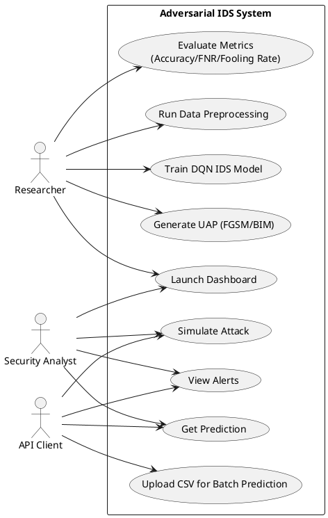
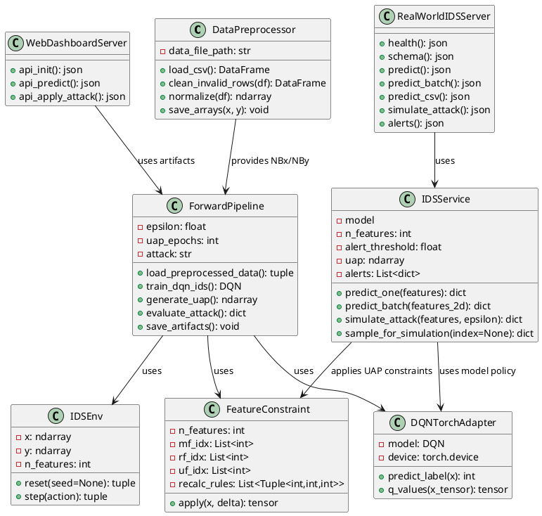
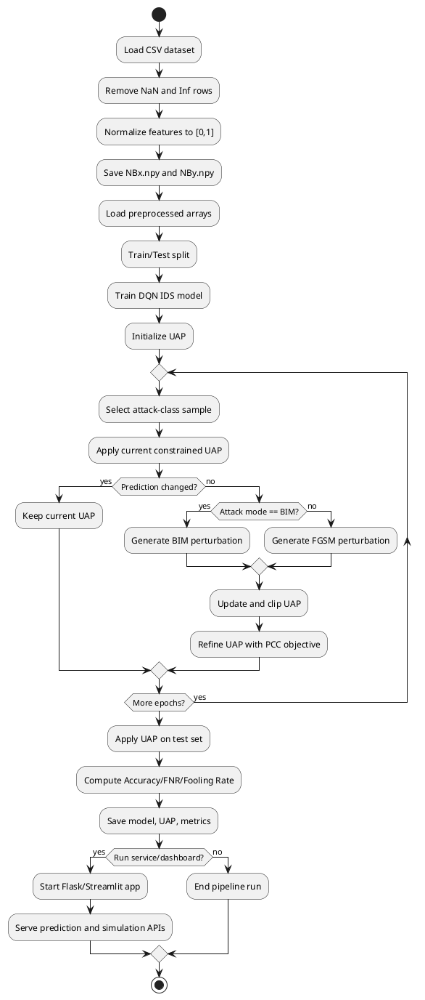
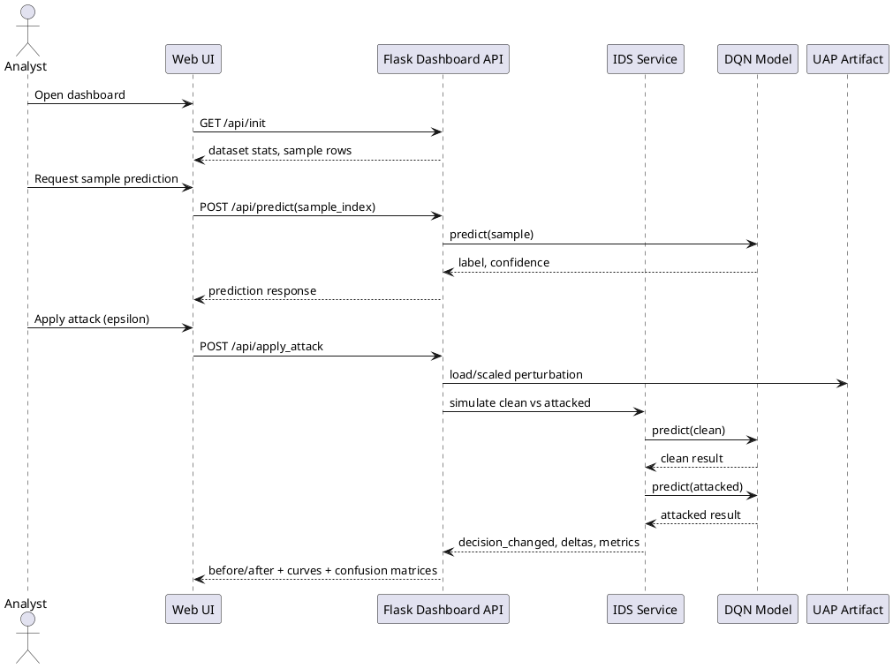
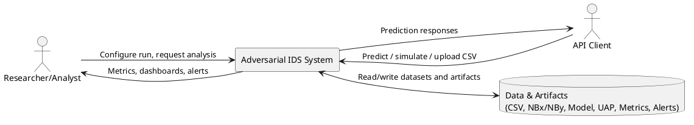
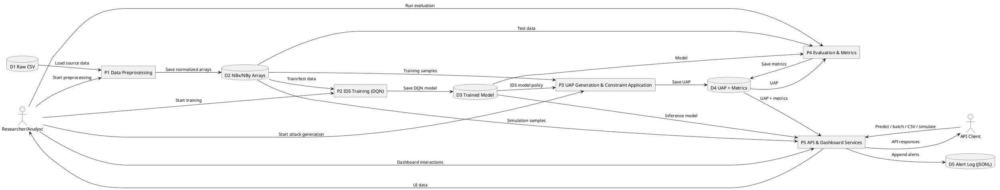
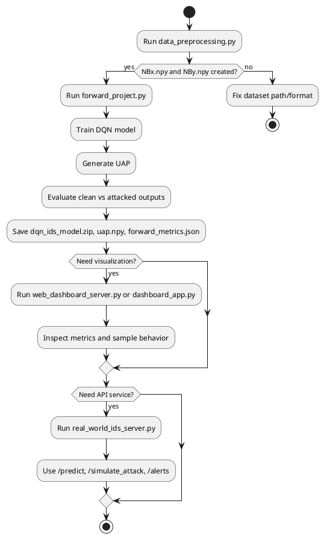
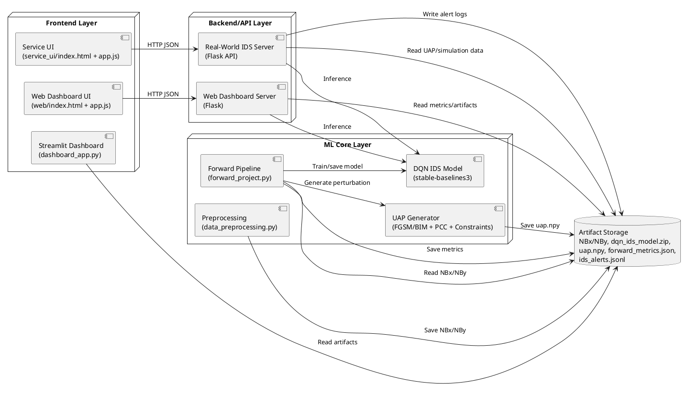

# PlantUML Diagrams

## 1. Use Case Diagram



## 2. Class Diagram



## 3. Activity Diagram



## 4. Sequence Diagram



## 5. Data Flow Diagram (Level 0)



## 6. Data Flow Diagram (Level 1)



## 7. Flowchart



## 8. Proposed System Architecture Diagram



## 9. Gantt Chart

```plantuml
@startgantt
Project starts 2026-01-01
printscale weekly
saturday are closed
sunday are closed

[Requirement Gathering] as [RG] lasts 2 weeks
[Design] as [DS] lasts 2 weeks
[Development] as [DV] lasts 6 weeks
[Testing] as [TS] lasts 3 weeks
[Deployment] as [DP] lasts 1 weeks

[DS] starts after [RG]
[DV] starts after [DS]
[TS] starts after [DV]
[DP] starts after [TS]
@endgantt
```
